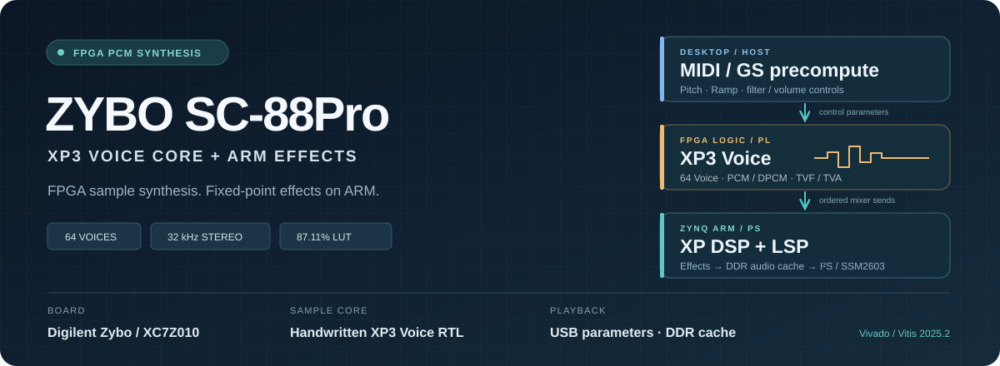
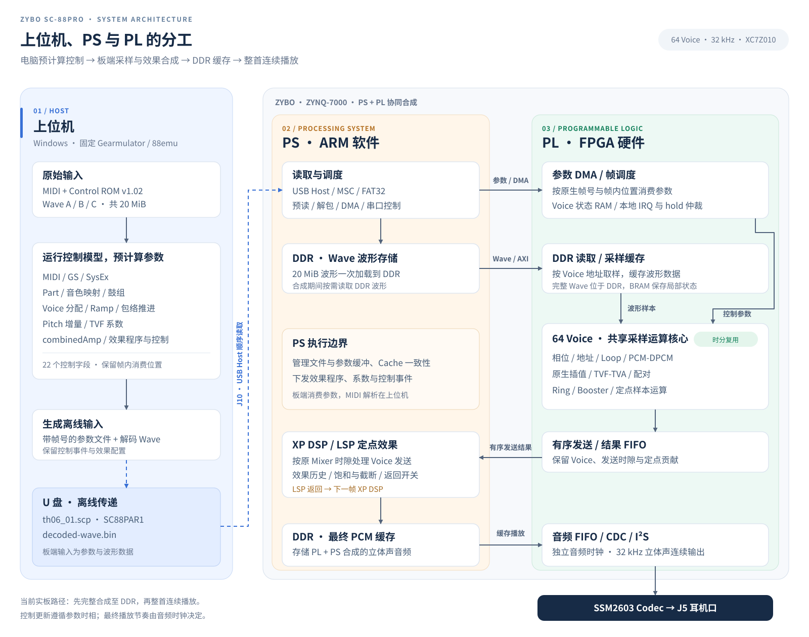
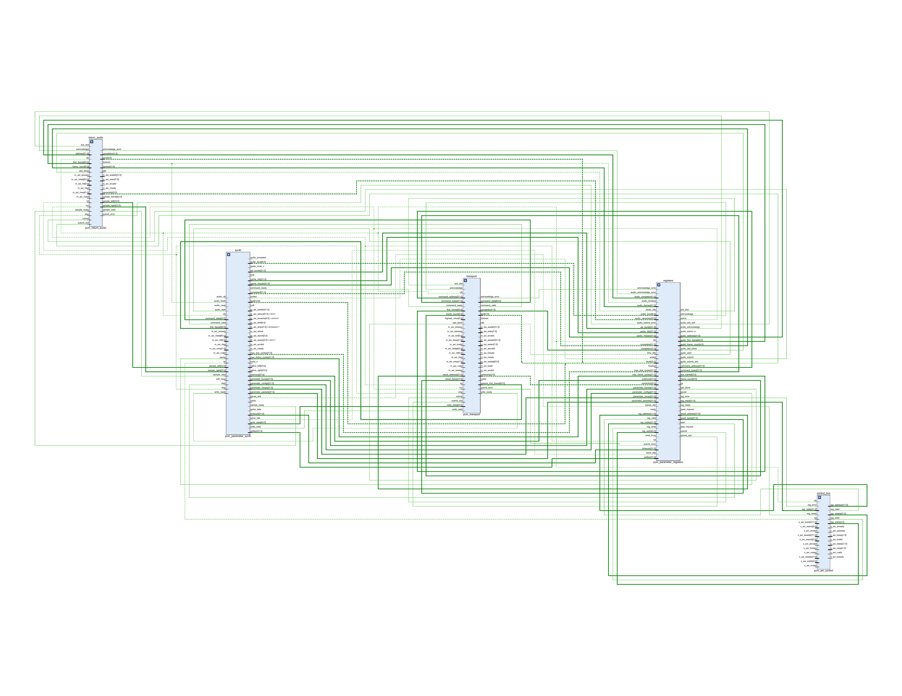
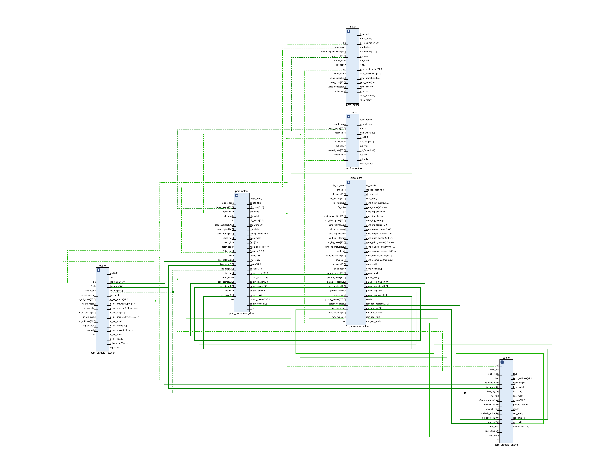
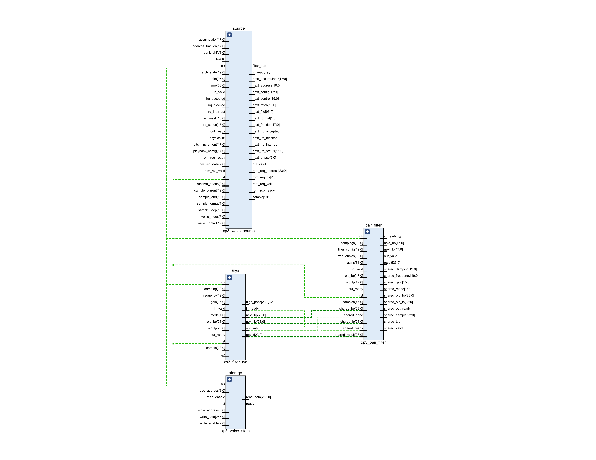

<div align="center">



# Zybo SC-88Pro

**在原版 Zybo 上，以手写 FPGA 实现 XP3 采样核心，配合上位机控制预计算与 ARM 效果处理重现 SC-88Pro 数字音源。**

64 Voice · 32 kHz · 20 MiB Wave ROM · U 盘参数流 · XP DSP / LSP · SSM2603

<p>
  
  
  
  
</p>

[复刻范围](#复刻范围) · [FPGA 资源](#fpga-资源) · [硬件架构](#硬件架构) · [快速上手](#快速上手) · [验证结果](#验证结果) · [源码构建](#源码构建)

</div>

本项目将 SC-88Pro 的控制、采样合成和效果处理分配到电脑、Zynq PL 与 PS：电脑使用固定 Gearmulator / 88emu 参考及原版 ROM，提前把 MIDI 演奏转换为带原生帧号的控制参数；Zybo 从 U 盘读取参数与波形，在 FPGA 中合成 Voice，由 ARM 执行 XP DSP/LSP，再经 I²S 和板载 SSM2603 从 **J5 耳机口**输出。

当前实板路径为**先在板端完整合成到 DDR，再整首连续播放**。缓存来自板端运算，软件参考 PCM 仅用于比较。已完成红魔乡体验版 `th06_01` 的整曲数字比对与实际 Line In 录音。

## 项目亮点

| 能力 | 实际实现 |
| --- | --- |
| **64 Voice 采样核心** | 共享运算单元、时分调度与 Voice 状态 RAM，保留原生 32 kHz 时间基准。 |
| **原生定点运算** | PCM/DPCM、相位、Loop、插值、TVF/TVA、配对与 Ring/Booster，按固定参考的位宽、截断及饱和规则实现。 |
| **原版波形输入** | 20 MiB Wave ROM 在电脑端解码，板端加载到 DDR；FPGA 通过采样缓存读取。 |
| **XP DSP / LSP 效果** | ARM 执行定点效果程序，保留有序 Mixer 时隙、效果历史和跨帧返回。 |
| **U 盘离线输入** | USB Host、MSC、FAT32、参数解包及 DDR 缓冲，串口控制合成与播放。 |
| **整曲结果可查** | 指定曲目完整数字输出与固定参考逐样本逐位一致，实际模拟录音及比较报告可查。 |

## 复刻范围

**FPGA 部分主要实现 XP3 芯片的 Voice 采样合成核心**，包括 64 Voice、PCM/DPCM 解码、相位与 Loop、原生插值、TVF/TVA、配对、Ring/Booster 和有序发送。

XP3 的功能由三个位置共同承担：上位机预计算 Ramp、Pitch、TVF 系数和音量等控制参数；PL 执行逐样本的 Voice 发声运算；PS 执行 XP3 内部 DSP 的混音与效果，并实现原机独立 LSP 芯片的效果处理。因此，本项目采用分工方式复现 SC-88Pro 的数字音源行为，完整 XP3 的全部逻辑并未集中实现于 FPGA。

各部分的位置与当前范围如下：

| SC-88Pro 功能 / 部件 | 实现位置 | 当前范围 |
| --- | --- | --- |
| MIDI、GS/SysEx、Part、音色映射、鼓组与 Voice 分配 | **电脑** | 固定整机参考运行 Control ROM v1.02，导出控制结果；板端消费参数。 |
| Ramp/包络推进、Pitch 增量、TVF 系数、combinedAmp | **电脑** | 提前计算 22 个控制字段，在原消费阶段更新；PL 保留所需的本地 IRQ/hold 仲裁。 |
| XP3 Voice 采样数据通路 | **FPGA / PL** | 64 Voice 状态、相位/地址/Loop、PCM/DPCM、原生插值、TVF/TVA 样本运算、配对和 Ring/Booster。 |
| Voice 发送与 Mixer | **PL + ARM / PS** | PL 产生有序定点发送结果；PS 在 XP DSP 原执行时隙中沉积、混合并处理。 |
| XP DSP 与 LSP | **ARM / PS** | 执行效果程序、系数和状态，保留串行总线返回与跨帧反馈；当前完整实曲验收覆盖 `th06_01` 使用的效果路径。 |
| Wave ROM | **DDR + PL 采样缓存** | Wave A/B/C 共 20 MiB；保留原波形输入，完整 Wave 不放入 BRAM。 |
| 数字音频输出 | **PL + SSM2603** | 音频 FIFO、跨时钟域、32 kHz 立体声 I²S、J5 模拟输出。 |

控制导出路径包含 Note On/Off、Bank/Program、力度、音量、Expression、Pan、Pitch Bend、Sustain、Modulation、All Notes/All Sound Off、GS Reset、常用 GS SysEx、鼓组及 SC-88Pro 扩展音色。这些能力属于电脑控制模型和参数导出链路；板端当前不解析 MIDI，也不提供 USB-MIDI 实时演奏。

原机 H8 CPU 的物理 RTL、LCD/面板、Roland 总线电气行为、原机 DAC 与模拟滤波电路不在实现范围内。数字精度以同 ROM、同 MIDI 的固定软件参考为依据；现有验收不代表与真实 SC-88Pro 模拟输出逐样本一致，也不代表全部音色、效果和歌曲均已实板验证。

## FPGA 资源

统计来自 **2026-10-11、Vivado 2025.2、`sc88_wrapper` 最终 Routed 设计**，目标器件为原版 Zybo 的 **XC7Z010CLG400-1**。

| 资源 | 已使用 | 器件总量 | 占比 |
| --- | ---: | ---: | ---: |
| **Slice LUTs** | **15,331** | **17,600** | **87.11%** |
| Slice Registers / FF | 14,925 | 35,200 | 42.40% |
| Block RAM Tile（36 Kb 等效） | 27 | 60 | 45.00% |
| DSP48E1 | 7 | 80 | 8.75% |

LUT 总数包含 **14,263 个逻辑 LUT** 和 **1,068 个存储/移位 LUT**；BRAM 为 22 个 RAMB36 加 10 个 RAMB18。LUT 数量余量为 **2,269 个（12.89%）**，但当前布局已使用全部 4,400 个 Slice，数量余量不等于可直接添加同等规模逻辑的布局及时序余量。

这份统计包含音源、DMA、AXI、采样缓存、音频输出及调试电路，PS 上的软件控制与效果处理不计入 LUT。

| 层次 / 模块 | LUT | 占器件总 LUT |
| --- | ---: | ---: |
| 完整工程 `sc88_wrapper` | 15,331 | 87.11% |
| 参数多 Voice 核 `pcm_parameter_voice_scheduler` | 11,017 | 62.60% |
| 其中：共享 Voice 运算核 `xp3_parameter_voice` | 4,762 | 27.06% |
| 两个 ILA + `dbg_hub` | 1,895 | 10.77% |

多 Voice 核包含 Voice 运算、参数 DMA、Mixer、结果 FIFO、采样读取与缓存；表中父子层次有包含关系，不能相加。调试开销来自当前镜像的层次报告，未另行构建精简镜像。

PL 合成时钟为 **83.333333 MHz**，独立音频主时钟约 **12.2880025 MHz**；最终 WNS **+0.201 ns**、WHS **+0.025 ns**。DRC 与关键 CDC 检查通过，ILA 配置握手的限定豁免见对应报告。

公开报告：[资源总表](verification/final-board/utilization.rpt)、[层次资源](verification/final-board/utilization-hierarchical.rpt)、[构建与时序摘要](verification/final-board/summary.json)。摘要中的 `hardware_verified=false` 表示构建检查本身不证明实板行为；整曲实板结果由下方独立数字与录音比较摘要说明。

## 硬件架构



[在浏览器打开 HTML 图示](docs/readme-assets/architecture.html) · [SVG 矢量图](docs/readme-assets/architecture.svg)

参数包含原生帧号及必要的帧内执行位置。合成按参数和缓冲握手推进，播放由独立音频时钟驱动；USB 到达时间不决定采样时间。XP DSP/LSP 保持原 Mixer 时隙和反馈位置，内部 16 帧处理块之间保持音源与效果状态连续。

<details>
<summary><strong>查看板级包装层、多 Voice 调度与 XP3 Voice 核的 RTL 图</strong></summary>

#### 板级 AXI / DDR / 音频包装层



`control_bus` 和 `registers` 处理 AXI4-Lite 控制与状态；`transport` 读取参数块并写回结果；`synth` 连接参数音源核心与音频输出；`return_audio` 从 DDR 读取最终 PCM，供连续播放。

[源码](hardware/board/pcm_parameter_board.sv) · [矢量 PDF](docs/readme-assets/pcm_parameter_board_rtl.pdf)

#### 64 Voice 参数调度与采样系统



`parameters` 按帧内消费位置提供控制字段；`voice_core` 时分处理 Voice；`cache` 与 `fetcher` 完成波形缓存及共享 DDR 读取；`mixer` 生成有序发送与定点混音结果；`results` 按完整帧缓冲结果。64 Voice 使用共享运算核和各自状态。

[源码](hardware/rtl/pcm_parameter_voice_scheduler.sv) · [矢量 PDF](docs/readme-assets/pcm_parameter_voice_scheduler_rtl.pdf)

#### XP3 Voice 共享运算核



`storage` 保存 Voice 状态；`source` 完成相位、Loop、PCM/DPCM 解码与原生插值；`filter` 执行 TVF/TVA 定点样本运算；`pair_filter` 处理配对结构，并共享滤波/音量运算单元。参数消费与本地 IRQ/hold 仲裁由顶层控制逻辑组织。

[源码](hardware/rtl/xp3_parameter_voice.sv) · [矢量 PDF](docs/readme-assets/xp3_parameter_voice_rtl.pdf)

三图由 Vivado 2025.2 展开当前 SystemVerilog 源码，展示各层直属模块及连接；详细控制逻辑和运算单元可在 Vivado 的 Elaborated Design 中继续展开。XP DSP/LSP 在 ARM 上执行，见上方 PS/PL 分工图。

</details>

| 源码入口 | 职责 |
| --- | --- |
| [xp3_parameter_voice.sv](hardware/rtl/xp3_parameter_voice.sv) | 参数消费、Voice 状态与共享采样运算。 |
| [hardware/rtl](hardware/rtl/) | 波形解码、插值、滤波、配对、调度、Mixer、缓存与参数 DMA。 |
| [hardware/board](hardware/board/) | Zybo PS/PL 集成、AXI、结果/返回音频、CDC、I²S 与构建脚本。 |
| [software/ps](software/ps/) | USB Host、FAT32、参数读取、串口控制、板端缓存与效果处理。 |
| [sc88_parameter_effects.cpp](software/ps/sc88_parameter_effects.cpp) | 有序发送到 XP DSP/LSP 的定点效果与跨帧返回。 |
| [host/offline_player](host/offline_player/) | 参数格式与独立软件重放。 |
| [reference](reference/) · [verification](verification/) | 固定参考、接口契约与各阶段验证摘要。 |

音源和板级硬件均采用手写 SystemVerilog。固定 C++ 参考用于导出与数值比对；当前实板核心未采用 HLS 生成硬件。

## 快速上手

### 1. 连接开发板

适用硬件：**原版 Digilent Zybo / XC7Z010 / 512 MiB DDR3 / SSM2603**。

| 接口 / 跳线 | 配置 |
| --- | --- |
| **J15 / JP7** | 外部 5 V 电源，JP7 = WALL；USB Host 模式使用独立供电。 |
| **J10 USB-A / JP1** | 接 U 盘，JP1 短接，PS USB0 Host。 |
| **J9 USB OTG** | 保持断开，与 J10 共用 USB0。 |
| **J11 PROG/UART** | 接电脑，JTAG 下载及 115200 / 8N1 串口控制。 |
| **JP5** | JTAG 启动配置。 |
| **J5 Headphone Out** | 接耳机、有源音箱或电脑 Line In。 |

U 盘根目录准备 `decoded-wave.bin` 与 `th06_01.scp`。Wave 和参数须由自己的 ROM/MIDI 生成，不能放入软件参考 PCM 作为播放输入。当前固件的曲目入口为 `th06_01.scp` 至 `th06_07.scp`，完整实板验收仅第一首。

### 2. JTAG 加载配套固件

本地配套文件为：

| 文件 | 用途 |
| --- | --- |
| `sc88.bit` · `sc88.xsa` | 当前参数音源 FPGA 配置与硬件平台。 |
| `parameter_player.elf` | 含 XP DSP/LSP 的 ARM 固件。 |
| `ps7_init.tcl` | 与当前 XSA 配套的 PS 初始化。 |

这些文件位于忽略的 `build/` 目录，源码仓库需自行构建。在项目根目录运行，工具路径及线缆序列号改为自己的实际配置；`hw_server` 使用端口 3121：

```powershell
$env:VITIS_ROOT = '<Vitis 2025.2 安装目录>'
$cableSerial = '<你的 JTAG 线缆序列号>'
& "$env:VITIS_ROOT/bin/xsct.bat" scripts/parameter_jtag.tcl `
  build/verification/offline-player/phase-04/board/sc88.xsa `
  build/verification/offline-player/phase-04/board/sc88.bit `
  build/verification/offline-player/phase-04/parameter-effects-ps/parameter_player.elf `
  build/verification/offline-player/phase-04/parameter-effects-ps/ps7_init.tcl `
  load $cableSerial
```

### 3. 合成与播放

打开对应串口，设置 **115200 / 8N1**，按顺序发送单字符：

| 命令 | 行为 |
| --- | --- |
| `h` | 启用 USB Host，等待 U 盘枚举。 |
| `w` | 从 U 盘加载 Wave 到 DDR。 |
| `1` | 读取第一首参数并完整合成到板端 DDR。 |
| `s` | 查询状态。 |
| `p` | 连续播放整首缓存音频及尾音。 |
| `x` | 停止播放。 |

第一首合成完成应为 `result=1`、`frames=2345791`、`pl_fault=0`、`ps_fault=0`，再发送 `p`。读盘和合成期间状态回复可能延迟数十秒；合成速度不以实时播放为保证。保持供电及缓存时，可以再次发送 `p` 重播。

当前交付使用 JTAG，尚未交付 QSPI 自启动、SD 启动镜像或 USB-MIDI 音源模式。

## 验证结果

实板环境：**原版 Zybo / XC7Z010 · Vivado / Vitis 2025.2 · `th06_01` · PL 83.333333 MHz**。以下为既有实测记录，范围限于对应 bit/XSA/ELF 组合及指定曲目。

| 项目 | 结果 |
| --- | --- |
| 完整板端合成 | **2,345,791 帧**，含 256,000 帧启动段与曲目/尾音。 |
| 数字精度 | 启动段与 **2,089,791 帧**曲目/尾音均与固定参考逐样本逐位一致，最大误差 **0**。 |
| 连续播放 | **65.306 秒**曲目及尾音，FIFO 排空；PL/PS/USB 故障及重试均为 **0**。 |
| 实际录音 | J5 → 电脑 Line In，44.1 kHz / 双声道 / 16-bit，连续录音，无削波。 |
| 固定时钟差 | **−12.956 ppm**，11 个窗口拟合残差均小于 0.08 个采样点。 |
| 左 / 右相关系数 | **0.999886 / 0.999854**。 |
| 左 / 右归一化 RMS 误差 | **1.68% / 2.00%**。 |
| 左 / 右信噪比 | **52.04 / 51.88 dB**。 |

模拟比较使用固定采集延迟、固定声道电平系数和直流偏置；仅对参考音频应用实测固定时钟比例校正，录音样本保持原样。原始未校正比较未通过，校正比较通过。数字零误差与模拟录音误差分别统计。

公开摘要：[完整数字比较](verification/offline-player/effects/digital-comparison.json)、[模拟比较](verification/offline-player/effects/comparison-clock-corrected.json)、[原始未校正比较](verification/offline-player/effects/comparison.json)。原始录音、PCM、曲目参数及 ROM 派生载荷由使用者本地保存，不随源码分发。

## 源码构建

硬件与 ARM 固件使用 **Vivado / Vitis 2025.2**；主机脚本使用 **Python 3.12、PowerShell 7**，电脑参数导出还需要 **Visual Studio 2022 Build Tools、CMake**。先通过 `VIVADO_ROOT` 与 `VITIS_ROOT` 指定工具安装目录，录音工具 `ffmpeg` 放入 PATH；串口、JTAG 线缆及录音设备由调用者指定。

准备固定版本依赖：Gearmulator 提交 `9af8bb05bcef2994b5dbb60c5c028e978a72aecb` 位于 `external/gearmulator`；TinyUSB 0.21.0 提交 `dae3f9a366bfcddbf9dcf1b48d7500286a849539` 位于 `external/tinyusb`。第三方源码通过固定提交的 Git 子模块获取，ROM 需自行本地准备，来源见 [第三方说明](THIRD_PARTY_NOTICES.md)。

获取源码与固定依赖，填写自己的工具安装目录，再构建参数导出/软件重放工具、完整 FPGA 及效果固件：

```powershell
git clone --recurse-submodules https://github.com/ryujou/zybo-sc88pro.git
cd zybo-sc88pro
$env:VIVADO_ROOT = '<Vivado 2025.2 安装目录>'
$env:VITIS_ROOT = '<Vitis 2025.2 安装目录>'
pwsh -NoProfile -File scripts/build_offline_player.ps1
py -3 -X utf8 host/build_parameter_board.py
py -3 -X utf8 host/build_parameter_ps.py --effects `
  --xsa build/verification/offline-player/phase-04/board/sc88.xsa
```

硬件输出到 `build/verification/offline-player/phase-04/board`；效果 ELF 和配套 PS 初始化输出到 `build/verification/offline-player/phase-04/parameter-effects-ps`。应使用同次构建的匹配 XSA、bitstream、ELF 和 PS 初始化文件。

## 许可与来源

项目自有核心与适配采用 **GPL-3.0-only**，详见 [LICENSE.md](LICENSE.md)。数字行为参考固定 [Gearmulator / 88emu](https://github.com/dsp56300/gearmulator)，USB Host 使用 [TinyUSB](https://github.com/hathach/tinyusb)，文件系统使用 Vitis 所附 FatFs；各自版权和许可证保留，详见 [THIRD_PARTY_NOTICES.md](THIRD_PARTY_NOTICES.md)。

OPL3 与 PC-98 工程用于板级配置、Codec、AXI、I²S、裸机和 JTAG 方法参考；SC-88Pro 音源核心独立实现。Roland ROM、原曲 MIDI、采样及可还原的私有派生数据由使用者自行提供，不因项目许可证获得分发授权。
